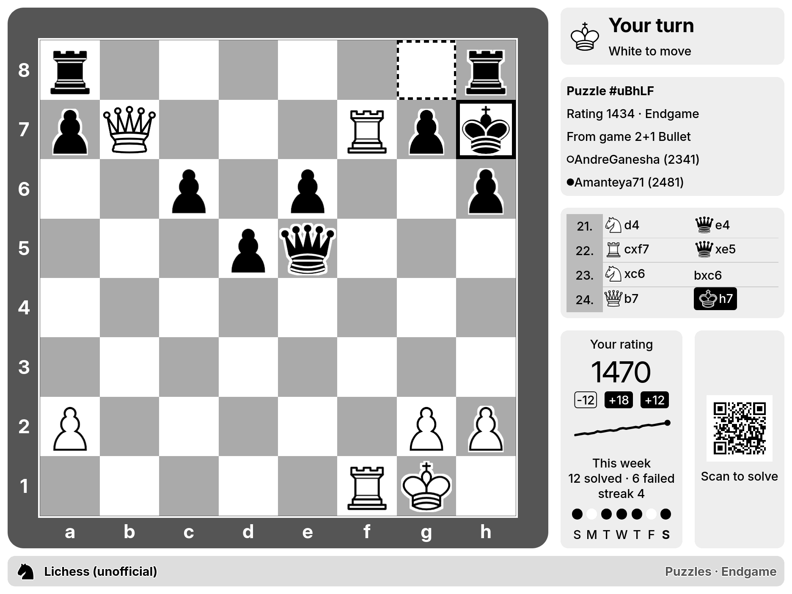
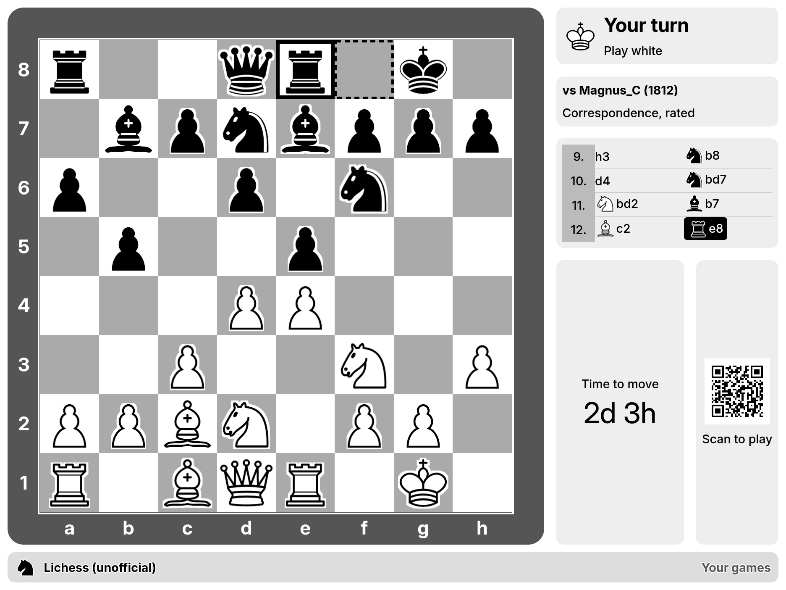
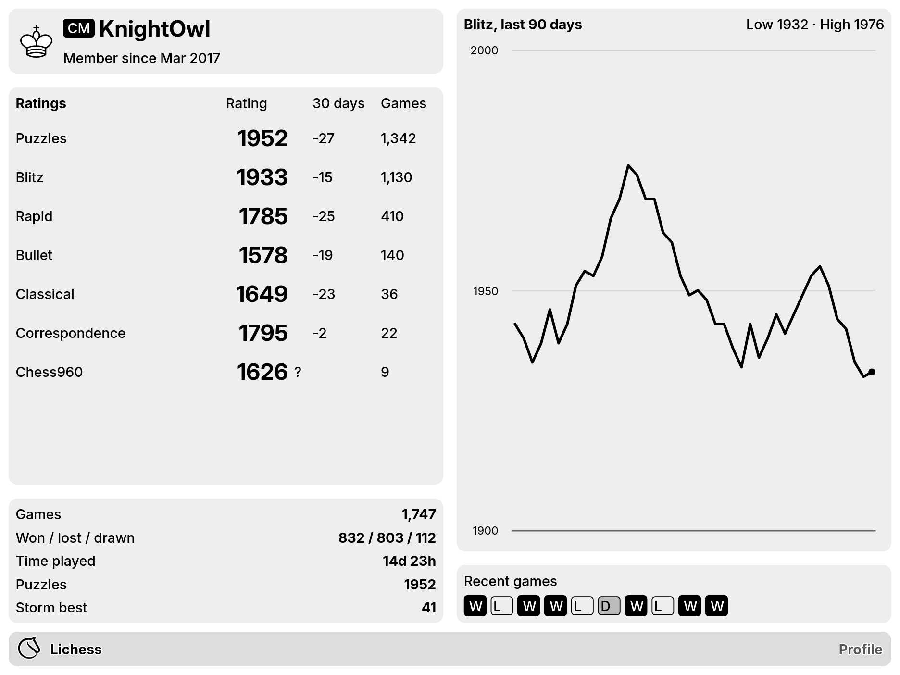
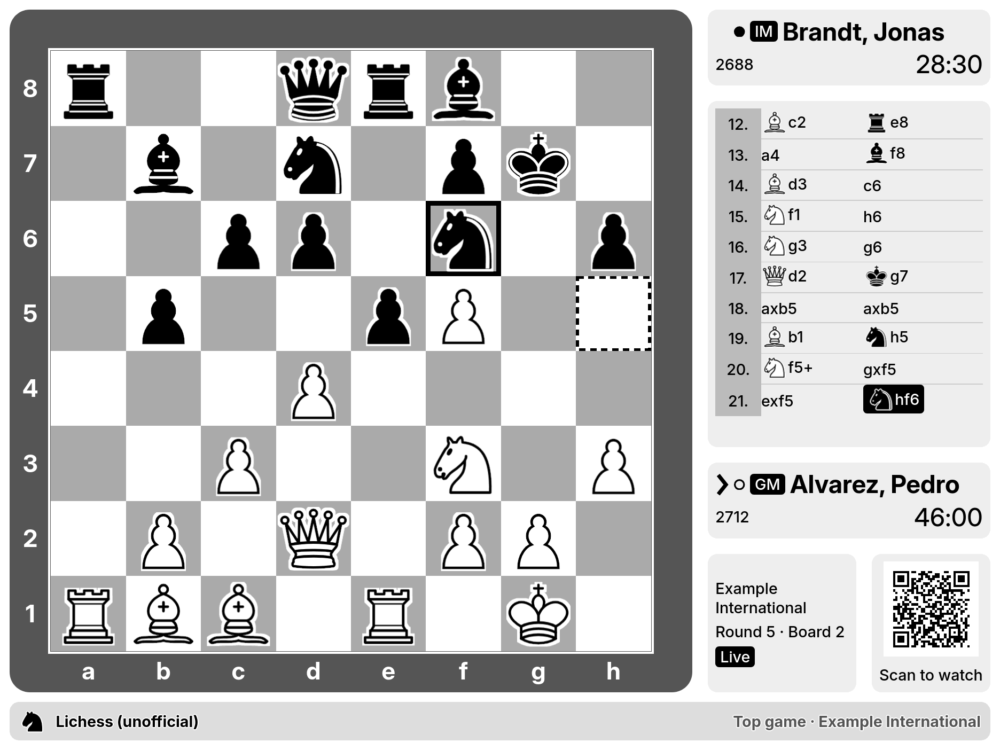
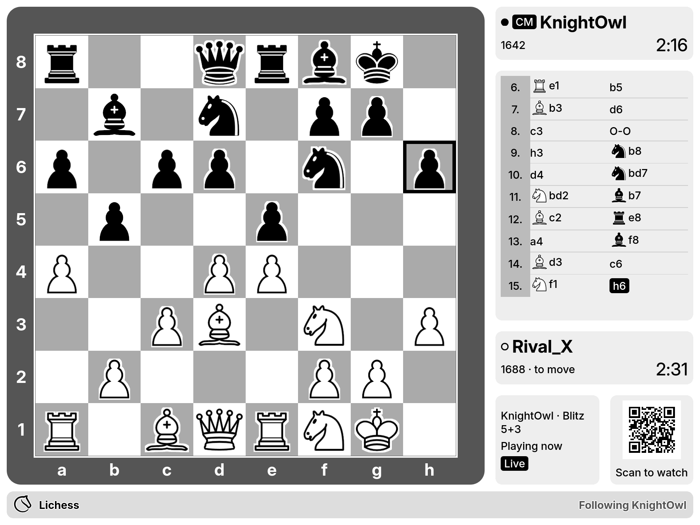

# Lichess for TRMNL

Unofficial. Lichess on your TRMNL: puzzles at your level, your correspondence games, your profile, top live games or a player you follow.

## Modes

| Mode | Shows |
|---|---|
| Puzzles | A puzzle at your rating (or your weakest theme), the moves that led to it, your rating and week, a QR code to solve it |
| Your games | The correspondence game where it is your turn, time left, moves, a QR code to play |
| Profile | Your main rating with its peak and 90-day chart, your other ratings with trends, this week's games and streak, recent games |
| Top game | The best live game now (a broadcast, else Lichess TV): players, clocks, moves, a QR code to watch |
| Follow a player | The current game of a player you name, or their last game |

## Setup

1. Add the plugin and press Connect Lichess (OAuth).
2. Pick a mode.
3. Optional: difficulty and puzzle focus (Puzzles), the username to follow (Follow a player).

| Setting | What it does |
|---|---|
| Difficulty | Easiest to hardest, relative to your puzzle rating |
| Mode | Puzzles, Your games, Profile, Top game, Follow a player |
| Puzzle focus | Any theme, or your weakest theme |
| Player to follow | Lichess username for Follow a player |

All four views, 1-bit, grayscale and dark mode. Texts are English.

## Privacy

Only reads your Lichess data, with the scopes shown on the Lichess consent screen. Nothing is stored outside TRMNL.

## Build and test

| What | Command |
|---|---|
| Build `plugin/src/transform.js` and `shared.liquid` from `source/` | `node tools/build.js` |
| Regenerate `source/pieces.js` | `node tools/pieces.js` |
| Logic tests | `node --test test/` |
| Rendered tests, lint | `cd plugin && trmnlp test`, `trmnlp lint` |
| Review sheets of every mode state | `tools/r6_sheets.sh` (after rendering into `renders/design/r6`) |

Edit `source/`, never the files in `plugin/src/` that the build writes. `settings.yml` comes from `trmnlp pull`. Handoff notes: [docs/NOTES.md](docs/NOTES.md).

## Credits and licence

Not affiliated with or endorsed by Lichess.org. Lichess, its knight logo and its data belong to Lichess; the logo appears as the plugin icon only to name the source. Puzzles are the Lichess CC0 database; data comes from its public API.

Pieces: Colin M.L. Burnett (Cburnett), BSD ([LICENSES/cburnett-BSD-3.txt](LICENSES/cburnett-BSD-3.txt)). chess.js 1.4.0 (BSD-2-Clause, Jeff Hlywa) is bundled in the transform ([LICENSES/chess.js-BSD-2.txt](LICENSES/chess.js-BSD-2.txt)). Everything else: MIT, see [LICENSE](LICENSE).
